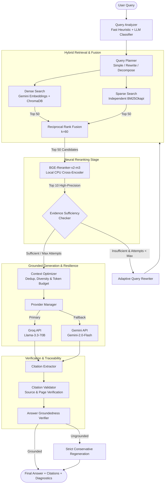

# Architecture Documentation — Advanced Agentic RAG Platform

## 1. System Architecture Overview

The Advanced Agentic RAG Platform is engineered to solve fundamental failure modes of naive RAG (semantic mismatch, out-of-domain vocabulary loss, context pollution, and hallucinated citations).

---

## 2. Key Architectural Subsystems

### A. Document Ingestion & Chunking
- **Unstructured Extraction**: Preserves structural tags (`Title`, `NarrativeText`, `ListItem`, `Header`), page numbers, and section breadcrumbs.
- **Semantic Chunking**: Accumulates coherent sections before applying token-boundary splits with configurable sliding overlap (default: 400 tokens / 60 token overlap).
- **Deterministic IDs**: `document_id` and `chunk_id` are computed via SHA-256 / xxHash for idempotent storage and deduplication.

### B. Hybrid Retrieval & Rank Fusion
- **Dense Vector Search**: Powered by Gemini Embeddings (`gemini-embedding-001`) with an on-disk `xxhash` content cache and persistent local ChromaDB.
- **BM25 Sparse Search**: Independent `BM25Okapi` index maintaining exact lexical term frequencies.
- **Reciprocal Rank Fusion (RRF)**:
  $$\text{RRF Score}(d) = \sum_{m \in \{\text{dense}, \text{bm25}\}} \frac{1}{k + \text{rank}_m(d)}$$
  Where $k = 60$. Combines semantic understanding with exact acronym/ID matching without fragile score calibration.

### C. Neural Cross-Encoder Reranking
- Uses `BAAI/bge-reranker-v2-m3` running locally on CPU.
- Evaluates full $(q, d)$ token interactions to condense top 50 hybrid candidates to the top 10 highest-precision passages.

### D. Adaptive Agentic Decision Engine
- **Query Classification**: Classifies queries into factual, comparison, multi-hop, multi-part, procedural, summarization, or ambiguous.
- **Query Decomposition**: Splits multi-hop queries into independent sub-queries.
- **Sufficiency Evaluation**: Evaluates whether retrieved evidence covers the query requirements. Retries with query expansion if deficient.
- **Conversational Memory**: Rewrites follow-up questions using recent turn context to generate standalone retrieval queries.

### E. Grounded Generation & Validation
- **Provider Resilience**: Automatic failover from Groq (Llama-3.3-70B) to Gemini (Gemini-2.0-Flash).
- **Citation Extraction & Validation**: Validates inline `[Source: file, p.X]` tags against the exact set of retrieved candidate chunks.
- **Answer Verification**: Verifies factual groundedness and flags unsupported statements.
